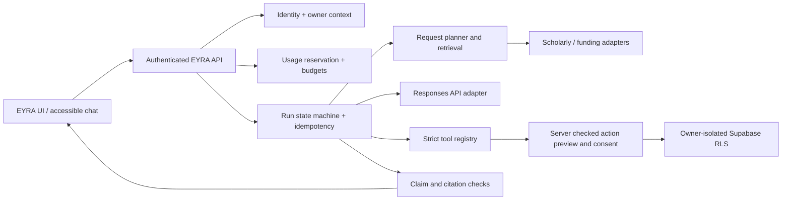

# EYRA Next — rebuilding the research assistant without losing user work

**Status:** phased reconstruction proposal and first reversible implementation slice. Not production approval. The EYRA v1 endpoints and user data remain intact until independently verified replacements exist.

## Product contract

EYRA is an evidence-aware research copilot, not a source of independently verified scientific facts. The default journey is **ask → retrieve → inspect provenance → reason → propose a next step**. Any irreversible or externally visible action must be reviewed independently of model output.

The six lenses (Research, Strategy, Funding, Venture, Team, Impact) share one scientific integrity policy. The lens changes the analysis focus, not permissions or evidence standards. A model-selected tool is never itself proof of user authorization.

## Current codebase baseline (17 November 2026)

- Server entry: `api/eyra.js` (~70 KB) combines Auth, quota, provider interaction and tool orchestration.
- Main client: `src/components/eyra/EyraCommandCenter.jsx` (~65 KB) mixes mode definitions, retrieval, conversation state, UI, tools and history.
- Additional entry paths use `src/lib/eyra-engine.js`; workflow parity needs explicit inventory.
- Cloud conversation/agent-run schemas are not known to exist in the live Supabase project; see draft PRs #530–#532.
- OpenAI provider 429 behavior remains a separate live acceptance blocker (#507).
- No existing draft PR is implicitly approved to merge or deploy.

## Target architecture and boundaries

Interfaces:

1. **Session & ownership.** Authenticate server-side for every request. Client-supplied resource IDs and context never prove ownership. Use RLS and explicit owner predicates; reject ambiguous session changes.
2. **Retrieval.** Normalize records as `{source_id, provider, canonical_url, title, date, doi?, abstract?, retrieval_status}`. Label metadata as metadata. Record partial upstream failure, stale cache, and absent full text.
3. **Scientific synthesis.** Only citations from the current evidence set. Identify claims as supported / inference / unresolved, and retain source links. Citation-ID validation is necessary but not sufficient; human claim-level checks are required.
4. **Model boundary.** Provider adapter with bounded input/output, cancellation, safe errors, retry rules and cost attribution. Never reveal prompts, tokens, provider payloads, or private workspace values in logs.
5. **Tool execution.** Strict server-side contracts and a per-user, per-run ledger. Exact field-level confirmation required before consequential writes. No autonomous destructive or external-send tools by default. Detect duplicate/lost-response retries without repeated writes.
6. **Durable conversations.** Explicit capability detection; cloud Save is disabled truthfully when schema is unavailable. Local export remains usable. Separate schema readiness from two-user hosted RLS acceptance.
7. **Frontend.** Split Command Center into reusable components for composer, timeline, source inspector, status, and action review. Preserve mobile, keyboard, screen reader, account switching and failure recovery.
8. **Operations.** Staging first. Production flags default off. No database migrations, provider billing, service-role changes or releases without independent authorization and signoff.

## Delivery batches / acceptance gates

| Batch | Implementation | Acceptance |
|---|---|---|
| 0 — Baseline | Inventory entry points, safety barriers, user journeys and tests | Exact commit, successful build/test and documented parity |
| 1 — Shared policy | Extract modes, prompts and scientific rules from Command Center | Deterministic tests; no change in effective UI prompts or output |
| 2 — API boundary | Extract auth, quota and provider adapter from monolith behind compatibility facade | Contract tests for 401, 413, 429, cancellation, refunds and malformed output |
| 3 — Evidence pipeline | Source provenance envelope, explicit full-text vs metadata distinction and bounded packets | Real-source sampling; adversarial prompt-injection and citation grounding evaluation |
| 4 — Agent engine | Durable state machine, tool registry, consent preview, cancellation and idempotency | Disposable staging two-user concurrency and lost-response acceptance |
| 5 — History | Cloud conversation support with graceful offline/export fallback | Staging migration/RLS, identity change, retry, version conflict and cleanup proof |
| 6 — UI | Reusable chat timeline, citations, tool review and recoverable error experiences | 390px mobile, keyboard, accessibility, signed-in end-to-end tests |
| 7 — Launch | Real OpenAI success/quota, SMTP, backup/rollback, deployment SHA and monitoring | Independent production release gate #309; explicit owner decision |

## Implemented reconstruction foundation in this PR

- `src/lib/eyra-next-policy.mjs`: single presentation-independent registry of six modes, six quick commands, language/style preferences and common evidence-bound prompt.
- Command Center consumes that registry, preserving existing visual icons and all existing workflows.
- The backend provider contract now separates quota/rate-limit classification, Responses output parsing and strict schema normalization from the API handler.
- The frontend retrieval planner now separates intent routing and bounded search-query construction from the React Command Center.
- A new backend identity boundary isolates Supabase bearer verification and optional billing entitlements from the agent loop.
- A pure latest-turn authorization module protects the existing write-intent gate against historical prompt text and inconsistent client-supplied turns; adversarial tests exercise exact matching.
- The server-side declarative tool registry is now separate from the request handler. Its tests freeze the current list of explicit write operations (`project.create` and `library.save_paper`) and reject duplicate or open argument schemas.
- The full workspace/scholarly tool executor is isolated from the HTTP orchestrator; strict argument contracts and bounded PostgREST response parsing are tested independently.
- Retrieval fanout for publications, authors, institutions and funding is now a transport-neutral module with partial-failure and cancellation tests. The React UI only supplies provider adapters.
- The provider-facing server system prompt is separately versioned as an auditable module.
- Identity-bounded project/paper/note context, monthly usage reservation/release, and false-write-permission protection are independent server modules with focused regression tests.
- Offline unit tests cover mode identifiers, provider error classification and schema normalization, and Greek/English retrieval routing.

**Explicit non-goals of this slice:** no declaration that the full EYRA has been rebuilt; no new endpoint, cloud persistence, schema migration, real model test, changed tool privileges, or production deployment. Keep this PR reviewable and verify CI at its exact head before considering integration.

## Security / release decisions

Do not silently merge the stacked PR chain #528 → #530 → #531 → #532. Reconcile that history with the current reviewed main before adopting any overlapping files. Run hosted tests only on an approved **separate staging** project and with disposable accounts. A synthetic green run is not real RLS, billing, SMTP or production verification.
