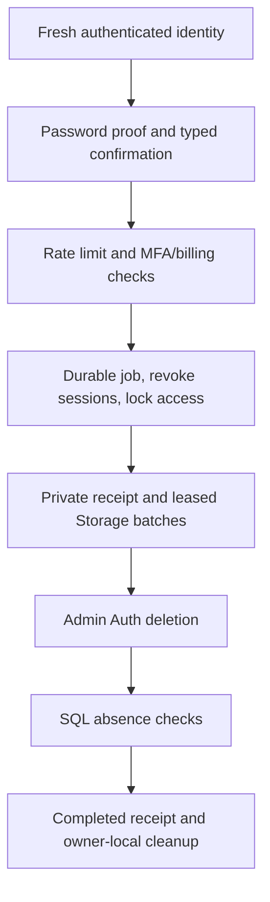

# Reauthenticated account deletion — staging candidate

This is an implemented **isolated, free-account/password staging workflow**, not production activation, a complete legal erasure response or verified hosted acceptance. `/account-deletion` is public so a scoped receipt can continue after the user's session is revoked; creating a request always requires fresh Auth, the current password and explicit permanent-deletion confirmation. Settings links to it. No remote migration or deletion was performed in this integration session.

## Activation and scope

The server requires all existing staging guards, `EYLO_PRIVACY_DELETION_ENABLED=true`, a server-only `EYLO_PRIVACY_WORKER_SECRET` of at least32 characters, and a Supabase server key. Live EYLO `kbzjngpzxpniaumlupaa`, unrelated `umzrggayitzfgrrofjnw`, an unconfirmed ref and `VERCEL_ENV=production` are refused before any service call. Normal previews display unavailable until configured. **Any configured Stripe secret/webhook disables this candidate**: pending billing/checkout/provider retention is not implemented. A server-controlled billing entitlement with a customer, subscription or paid plan also blocks initiation transactionally. Verified MFA factors and passwordless accounts need a separately reviewed verification workflow; they are not silently downgraded to password-only deletion.

Review `20261114063216_account_deletion_lifecycle.sql` only after independently verifying separate staging identity. It reuses existing canonical account/workspace/Storage contracts, existing billing tables and the single shared atomic rate-limit store. `private.account_deletion_jobs` stores lifecycle control only, never passwords, email, source documents or AI memory. All privileged RPCs revoke PUBLIC/anon/authenticated execution and grant only service_role. The local runner now executes21 selected existing+proposed migrations, including the existing billing entitlement migration; it is not the full historical chain or hosted Supabase advisors.

## Workflow and recovery



Initiation accepts no caller-supplied target identity: the user ID/email come from a fresh Auth `/user` response and password reauthentication must return that same ID. The ephemeral proof session is signed out even on a billing/schema error. Reauthentication is limited to5 attempts/minute per identity; progress is limited to30 requests/minute per job. Both budgets use existing atomic quotas with HMAC subjects, not raw IP/email/user identifiers.

Starting a job locks the Auth user row, creates one private job per account and removes current sessions in one transaction. Restrictive RLS applies across43 selected owner-data tables (40 workspace collections, profiles, billing entitlements and EYRA usage) and Storage. A private helper requires an extant, unbanned Auth user and no deletion job. This stops old JWT reads/writes independently of refresh/session revocation; old personal API tokens also fail their service-only lookup immediately. A volatile Storage metadata trigger serializes owner writes with the same Auth row and rejects late service/signed-upload metadata for locked or deleted identities. It does not establish byte-level upload-race behavior without actual hosted Storage tests.

A receipt is a job-bound HMAC bearer token. It authorizes only continuation/status of a confirmed deletion, exposes no workspace data and cannot select another job. The UI holds it in memory and offers an explicit private download; it is not placed in a URL or persistent browser storage. Losing a response or closing the page does not cancel a started request. There is no unsafe undo after permanent-deletion consent.

Each worker invocation leases one job for60 seconds, bans future sign-ins, fetches at most100 owned Storage metadata objects and removes at most three bucket groups using the Storage API. Ownership includes legacy owner/owner_id metadata and valid EYLO account-prefixed files, including orphan/version objects; conflicting/traversal paths are rejected. A request has bounded upstream deadlines and releases its lease on handled errors. A killed invocation is recoverable after lease expiry. The UI runs at most five bounded batches per Continue action and keeps the same receipt after an interruption. An operator can recover an already-confirmed abandoned job using:

```http
POST /api/account-deletion
Authorization: Bearer <server-only worker secret>
Content-Type: application/json

{"action":"worker"}
```

This processes the oldest eligible existing job; it cannot create a new deletion request. Configure a reviewed managed worker/recovery process before any real rollout. No automatic cron was enabled in staging and no production deployment was performed. Do not log the worker key, password, receipt or Authorization headers.

Auth deletion is attempted only after the Storage query is empty. An ambiguous successful Auth response can resume through404; the SQL completion RPC must independently find no Auth user, sessions, selected owner rows or owned Storage metadata before returning `complete`. Receipts do not claim success on a timeout, failed Storage call, busy lease or missing completion proof. A completed retry returns the same completed job without another Auth deletion.

The existing reviewer foreign key previously cascaded deletion into another author's manuscript. The proposal changes it to SET NULL while retaining the author's snapshot; authenticated INSERT still requires an accepted, non-null connection. Own manuscripts/reviews and shared team/connection structures follow their reviewed cascade semantics. Another user's private projects/Notes/files must remain unchanged.

## Browser data and retention limits

For a deletion started and completed in the same signed-in identity, the browser clears that owner's research catalog, Note/document drafts, operation/conversation retries, Offline vault and local session. Another owner's catalog/drafts and device preferences remain. Imported receipts never sign out an unrelated current account. Local cleanup failure is reported separately from server deletion.

Legacy Future Me, digital-twin, missions and pitch caches lacked ownership. They are now bound to an Auth boundary marker; unknown/changed owners cause these **legacy private cached values to be discarded**, including old cached goals that must be re-entered. Same-owner refresh retains current caches. Canonical database records and other owners' explicitly scoped catalogs/drafts are not removed by this cache migration. Tests cover this compatibility/security choice.

Completion clears the job's user_id; minimal job ID/status/timestamps/counters remain for receipt/recovery. This is not a legal anonymity or retention certification. Owners must review job/log/backup retention, external AI/meeting/payment providers and any historical schema outside the selected canonical contracts. The workflow does not erase earlier downloads, exports or browser data on other devices. Full DSAR, processor/backup erasure and paid/MFA/passwordless deletion remain separate unresolved requirements.

## Required hosted acceptance

Use two newly authorized disposable staging identities and a verified source/deployment. Test actual password proof/MFA refusal, cancelled consent, wrong-receipt denial, old JWT/personal-token lockdown, normal/version/orphan file bytes, in-flight/signed uploads, interruption/restart/lease recovery, Auth hard deletion, failed subsequent login, other-account private persistence and reviewer detachment. Verify actual Storage byte access as both old/deleted identity and the other account, not just metadata absence. Run Supabase advisors and review the deployed migration history first. Fixtures, bare PostgreSQL and successful preview builds do not satisfy these tests.
